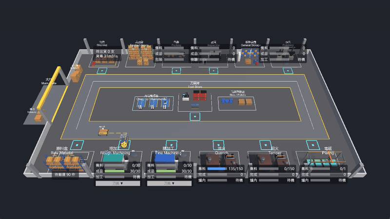

# OpenFleet



模擬機械加工廠的 AGV 資源調度系統：ASP.NET Core 後端負責狀態與運算，設備模擬器透過 MQTT 回報，Unity 負責 3D 顯示與操作。

## 目前進度

| 階段 | 內容 | 狀態 |
| --- | --- | --- |
| P1 通訊相容性 | .NET 後端、模擬器、Unity 之間以 MQTT 收送版本化 JSON，斷線重連、去重、快照對齊 | 完成 |
| P2 最小物料閉環 | PostgreSQL 持久化；批次由單車從原料倉送到粗加工、精加工、暫存，全程可追蹤；Unity 操作面板 | 完成 |
| P3 多車整合 | 雙車道路網與路段預約（完成）、缺車耽誤時間統計、小型 AGV 送刀具；三步都已實作，等使用者確認 | 進行中 |
| P4 完整流程 | 搬運失敗的恢復流程、批次分框、機床換線、淬火、回火、電鍍、拋光、品管與反工、包裝與出貨、一組三種零件（上沖、下沖、中模）、報廢自動補做、測試模式 | 完成，待確認 |
| P5 之後 | 下單、機台排程、雲端展示 | 規劃中 |

畫面中的站點佈局、批量與加工時間都是暫用的示範設定，不是定案的業務規則。

## 技術

- 後端：.NET 10、ASP.NET Core Minimal API、EF Core + PostgreSQL、MQTTnet、xUnit、Testcontainers
- 訊息：Mosquitto（MQTT）
- 顯示端：Unity 6（URP、UI Toolkit）、MQTTnet 4

## 目錄

| 位置 | 內容 |
| --- | --- |
| [backend/](backend/README.md) | 後端 API、共用契約、設備模擬器、測試；執行方式 |
| [unity/](unity/README.md) | Unity 專案與操作說明 |
| `docker/` | Mosquitto 與 PostgreSQL 的 Docker Compose |
| `document/` | 需求規劃與各階段的實作紀錄（決策、暫用設定、已知限制） |

## 快速開始

需要 .NET 10 SDK、Docker Desktop；看 3D 畫面另外需要 Unity 6000.5。

```bash
docker compose -f docker/compose.yaml up -d
dotnet run --project backend/src/OpenFleet.Api --launch-profile http
dotnet run --project backend/src/OpenFleet.Simulator
```

接著在 Unity 開啟 `unity/Openfleet` 的 `Assets/OpenFleet/Scenes/Factory.unity` 並按 Play，在右上面板按「建立批次」。沒有 Unity 也可以用 `curl -X POST localhost:5229/api/lots -H "Content-Type: application/json" -d "{}"` 建立批次，再用 `GET /api/lots/{id}` 追蹤。

設定檔中的帳號密碼、匿名的 MQTT 與沒有驗證的 API 都只供本機開發使用。
