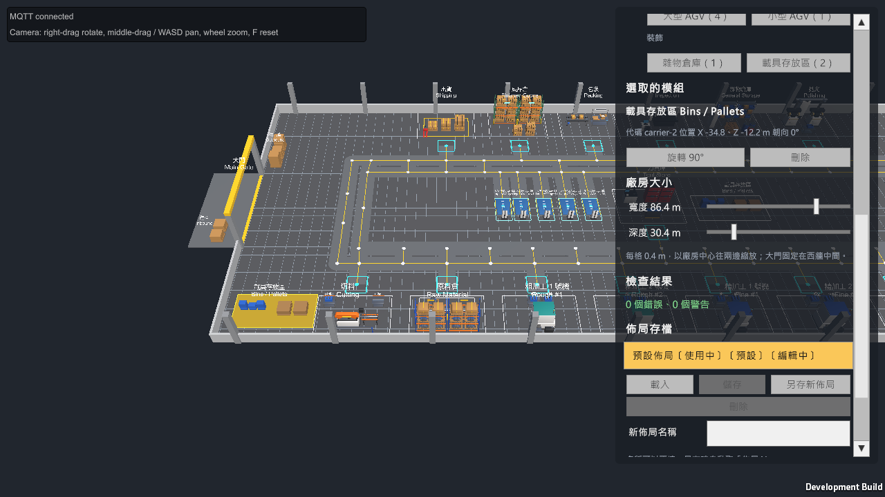

[](https://github.com/Tinyhello/OpenFleet/actions/workflows/backend-tests.yml)

# OpenFleet


模擬機械加工廠的 AGV 資源調度系統：ASP.NET Core 後端負責狀態與運算，設備模擬器透過 MQTT 回報，Unity 負責 3D 顯示與操作。

## 目前進度

| 階段 | 內容 | 狀態 |
| --- | --- | --- |
| P1 通訊相容性 | .NET 後端、模擬器、Unity 之間以 MQTT 收送版本化 JSON，斷線重連、去重、快照對齊 | 完成 |
| P2 最小物料閉環 | PostgreSQL 持久化；批次由單車從原料倉送到粗加工、精加工、暫存，全程可追蹤；Unity 操作面板 | 完成 |
| P3 多車整合 | 雙車道路網與路段預約、缺車耽誤時間統計、小型 AGV 送刀具 | 完成，待確認 |
| P4 完整流程 | 搬運失敗的恢復流程、批次分框、機床換線、淬火、回火、電鍍、拋光、品管與反工、包裝與出貨、一組三種零件（上沖、下沖、中模）、報廢自動補做、測試模式 | 完成，待確認 |
| P5 訂單與 BOM | 規格與 BOM、圓棒與備料庫存、採購、切料站、客戶訂單與生產工單、整張訂單出貨與負責人同意分批、開工時多做、成品倉、Unity 下單面板 | 完成 |
| P6 機台排程 | 粗加工、精加工各兩台車床、急單與交期優先的排程規則、排程預估、Unity 排程畫面 | 完成，待確認 |
| P7 沙盒佈局 | 機台、AGV 車位與路線都模組化：在 Unity 裡自己擺機台、畫路線、編輯廠房的尺寸與形狀，存成多份佈局；佈局有檢查，工廠清空時套用；預設佈局隨時可以回去 | 完成，待確認 |
| 之後 | 雲端展示 | 規劃中 |

畫面中的站點佈局、批量與加工時間都是暫用的示範設定，不是定案的業務規則。

## 沙盒佈局（P7）

工廠的佈局是一份可以編輯的資料，不再寫死在程式裡：

- **模組化**：每台機台一個模組（各有交接點、備料區與成品區），同一道工序可以擺好幾台；AGV 車位放一個就多一台 AGV；雜物倉庫、載具存放區等裝飾物也能擺。廠房的尺寸與形狀可以編輯：外牆是任意多邊形（牆可以斜），在場景裡拖牆角、拖整段牆、加刪轉角；大門可以放在任一面牆上。
- **自己畫路線**：路網由使用者在場景上畫，可以拖路口、刪路段；模組放下時自動接到最近的路。
- **多份佈局**：可以另存、載入、刪除；編輯時即時檢查（重疊、路段太短或交叉、交接點沒接上、車到不了原料倉等），有錯的佈局可以存、不能套用；預設佈局不能改也不能刪，隨時能回去。
- **清空時才套用**：套用時如果還有訂單在做，會提示「清空示範資料並套用」；套用後所有 AGV 回到各自的車位，Unity 與模擬器依新佈局重建。

後端與 Unity 共用同一個佈局程式庫（驗證、編輯規則），Unity 裡看到的檢查結果與後端套用前的檢查一致。API 見 [backend/README.md](backend/README.md#佈局p7)，操作方式見 [unity/README.md](unity/README.md#沙盒佈局編輯p7)，設計與決策見 [document/P7實作紀錄.md](document/P7實作紀錄.md)。



## 技術

- 後端：.NET 10、ASP.NET Core Minimal API、EF Core + PostgreSQL、MQTTnet、xUnit、Testcontainers
- 訊息：Mosquitto（MQTT）
- 顯示端：Unity 6（URP、UI Toolkit）、MQTTnet 4

## 目錄

| 位置 | 內容 |
| --- | --- |
| [backend/](backend/README.md) | 後端 API、共用契約、設備模擬器、測試；執行方式 |
| [unity/](unity/README.md) | Unity 專案與操作說明 |
| `docker/` | Mosquitto 與 PostgreSQL 的 Docker Compose |
| `document/` | 需求規劃與各階段的實作紀錄（決策、暫用設定、已知限制） |

## 快速開始

需要 .NET 10 SDK、Docker Desktop；看 3D 畫面另外需要 Unity 6000.5。

```bash
docker compose -f docker/compose.yaml up -d
dotnet run --project backend/src/OpenFleet.Api --launch-profile http
dotnet run --project backend/src/OpenFleet.Simulator
```

接著在 Unity 開啟 `unity/Openfleet` 的 `Assets/OpenFleet/Scenes/Factory.unity` 並按 Play，在右上面板按「建立批次」。沒有 Unity 也可以用 `curl -X POST localhost:5229/api/lots -H "Content-Type: application/json" -d "{}"` 建立批次，再用 `GET /api/lots/{id}` 追蹤。

設定檔中的帳號密碼、匿名的 MQTT 與沒有驗證的 API 都只供本機開發使用。
