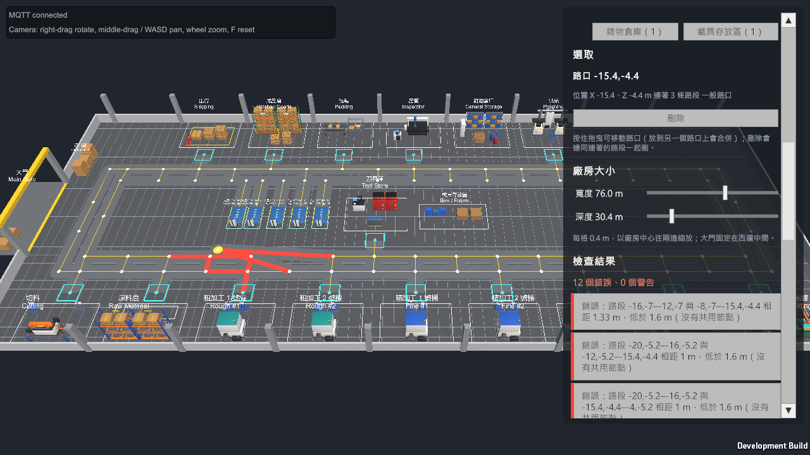

# OpenFleet Unity 顯示端

- P1：Windows 桌面版透過 MQTT 收到後端的車輛狀態、斷線後自動重連，並把背景執行緒收到的訊息切回主執行緒更新場景。
- P2：新增操作面板（UI Toolkit），可以修改示範設定、建立批次並查看批次目前的狀態與位置。
- P3：兩條車道與路徑虛線；面板顯示缺車耽誤的時間；Prefab 與 UI 設定改由程式從 Resources 載入，場景裡的腳本不在 Inspector 掛參考。
- P7（沙盒佈局）第 3 步：廠房、模組、路網與車位不再固定在 `Factory.unity` 裡，而是執行時向後端要使用中的佈局，自己建出來；佈局版本換了（MQTT）就自動重建。
- P7 第 4、5 步：操作面板的「佈局」頁與場景裡的滑鼠、鍵盤編輯：擺放機台、AGV 車位與裝飾物，畫路線，調廠房大小，佈局存檔與套用。

## 環境

| 項目 | 內容 |
| --- | --- |
| Unity | 6000.5.7f1、URP 17.5 |
| 目標平台 | Windows 桌面版（Mono） |
| MQTT client | MQTTnet 4.3.7 + MQTTnet.Extensions.ManagedClient 4.3.7（netstandard2.1 DLL，放在 `Assets/OpenFleet/Plugins`） |
| JSON | `com.unity.nuget.newtonsoft-json` 3.2.1，規則與後端相同（camelCase、enum 小寫字串） |
| 共用契約與佈局程式庫 | `OpenFleet.Contracts.dll`、`OpenFleet.Layout.dll`（模組目錄、幾何、驗證、預設佈局），由 `backend/src/OpenFleet.Contracts`、`backend/src/OpenFleet.Layout` 建置 |

## 檔案

| 位置 | 用途 |
| --- | --- |
| `Assets/OpenFleet/Scripts/FleetMqttClient.cs` | 連線 Broker、訂閱 `state/vehicles/+` 與佈局版本（`layout`）；背景執行緒解析 JSON 後放進佇列，由 `Update` 在主執行緒發出事件。車輛的 state Topic 被清掉（空的 retained 訊息，車被拿出佈局）時發出 `VehicleStateCleared` |
| `Assets/OpenFleet/Scripts/PresentationController.cs` | 表演用的控制器：從 Resources 載入 AGV Prefab、模組 Prefab、環境材質與 UI 設定、建立車輛與兩個 UI 面板；收到新建好的站點時換上（`SetStations`、`StationsChanged`）；介面大小（依畫面高度與使用者調整的倍數）；畫面上的顏色集中在它的 `Colors` |
| `Assets/OpenFleet/Scripts/FleetView.cs` | 每次連上 Broker 與每次佈局建好就取一次 HTTP 快照，把車輛狀態交給對應的車輛物件；簡易面板可送 Ping、跟隨車輛；左上狀態列在還沒有佈局時顯示「等待後端佈局…」 |
| `Assets/OpenFleet/Scripts/Layout/LayoutController.cs` | 向後端要使用中的佈局（後端沒開就每 3 秒重試）、建場景；收到佈局版本和目前不同就重新要、重建；重建後換站點、移除不在車輛清單的車、更新攝影機預設視角 |
| `Assets/OpenFleet/Scripts/Layout/LayoutScene.cs` | 依佈局文件建出 `Factory`：環境（地面、牆、柱子、大門）、路網（每條路段一片鋪面加中心線、節點補角的圓）、每個模組（載入 Prefab，物件名稱＝模組代碼） |
| `Assets/OpenFleet/Scripts/Layout/LayoutEditor.cs` | 沙盒編輯：草稿、選取、擺放與拖曳、畫路線、滑鼠與鍵盤、檢查結果與紅黃標記、場景重畫。所有修改都經過共用程式庫的 `LayoutEditSession`，這裡只做輸入與繪製 |
| `Assets/OpenFleet/Scripts/ProductionPanel.Layout.cs` | 操作面板的「佈局」頁：編輯工具列、新增模組、選取的項目、廠房大小、檢查結果、佈局存檔與套用 |
| `Assets/OpenFleet/Scripts/Layout/LayoutClient.cs` | 佈局的 HTTP 呼叫（列出、取得、另存、覆蓋、刪除、驗證、套用）；coroutine 加 callback |
| `Assets/OpenFleet/Scripts/Layout/LayoutMaterials.cs`、`Shapes.cs` | 執行時建環境用的材質清單（ScriptableObject）；基本幾何（方塊、圓柱、地面框線、文字標籤）的小工具，Editor 組 Prefab 與執行時建環境共用 |
| `Assets/OpenFleet/Scripts/VehicleView.cs` | 單台車的顯示（掛在 Prefab 上）：依 `stateEpoch` + `version` 丟棄舊狀態，位置插值、燈條與警示燈依連線狀態變色。燈條、標籤、貨物依子物件名稱找到 |
| `Assets/OpenFleet/Scripts/FactoryCameraController.cs` | 攝影機：右鍵旋轉、中鍵／WASD 平移、滾輪縮放、F 回到預設視角、跟隨車輛；預設視角依廠房大小（`SetHome`） |
| `Assets/OpenFleet/Scripts/ProductionPanel.cs` | 操作面板（UI Toolkit，介面用程式建立）：示範設定、測試模式、缺車耽誤、品管、出貨。只呼叫後端 HTTP API |
| `Assets/OpenFleet/Scripts/ProductionPanel.Orders.cs` | 操作面板的下單與訂單（P5）：建立客戶訂單、訂單與工單的進度、出貨單、料框位置、同意分批出貨 |
| `Assets/OpenFleet/Scripts/StatusOverlay.cs` | 場景物件上的進度條（UI Toolkit，螢幕座標）：機台的備料、成品、每台機台的加工與可收合的刀具列；車輛與站點交接的進度；車輛前往目的地的流動虛線；站點換了（佈局重建）時丟掉舊的進度條、依新的站點重建 |
| `Assets/OpenFleet/Scripts/StationAnchor.cs` | 場景中的站點與後端站點代碼的對應（物件名稱＝站點代碼，由 `LayoutScene` 加上）；進度條的位置、備料區／成品區有料時要顯示的物件 |
| `Assets/OpenFleet/Scripts/Billboard.cs` | 文字標籤面向攝影機 |
| `Assets/OpenFleet/Editor/FactorySceneBuilder.cs` | 選單 **OpenFleet → Build Factory Scene**：產生材質、`Resources` 底下的 AGV Prefab、模組 Prefab、環境材質清單與 UI 設定，以及只有 Sun、Main Camera、OpenFleet 三個物件的 `Factory.unity`（會覆寫） |
| `Assets/OpenFleet/Editor/PlayerBuilder.cs` | 選單 **OpenFleet → Build Windows Player**：重建場景並建置 `Builds/Windows/OpenFleet.exe`（Development build）。**Build Windows Player (Release)** 輸出到同一個位置，畫面右下角沒有 Development Build 字樣，錄影、展示用 |
| `Assets/OpenFleet/Resources/Prefabs/` | AGV Prefab（`AGV_Large`、`AGV_Small`、`AGV_Unknown`），執行時以 `Resources.Load` 載入 |
| `Assets/OpenFleet/Resources/Prefabs/Modules/` | 每種模組（`ModuleKind`）一個 Prefab：`Module_<種類>.prefab`，共 17 個；內容是模型、占地框線、交接點方框、標籤文字（執行時才填） |
| `Assets/OpenFleet/Resources/Layout/LayoutMaterials.asset` | 執行時建環境與路網用的材質清單（由 Build Factory Scene 依 `Palette` 填入） |
| `Assets/OpenFleet/Resources/UI/` | UI Toolkit 的 PanelSettings 與主題（由 Build Factory Scene 產生），執行時以 `Resources.Load` 載入 |
| `Assets/OpenFleet/Editor/ModulePrefabs.cs` | 產生每種模組的 Prefab：占地、交接點、模型名稱來自共用程式庫的 `ModuleCatalog`（和後端驗證用同一份），這裡負責把它們畫出來 |
| `Assets/OpenFleet/Editor/VehicleModels.cs`、`ModelKit.cs` | AGV：擺放 Blender 模型，並產生執行時會切換的物件（狀態燈、載貨、標籤）；`ModelKit` 只負責載入 FBX |
| `Assets/OpenFleet/Models/*.fbx`、`Editor/ModelImport.cs` | Blender 匯出的模型與匯入設定；材質依名稱換成 `Palette` 的材質 |
| `Blender/` | 模型的原始檔（`Models/*.blend`）與產生模型的腳本（`scripts/*.py`、`ofkit.py`）；不在 `Assets` 底下，Unity 不會匯入 |
| `Assets/OpenFleet/Editor/Palette.cs` | 模型的材質顏色（建場景時使用）；執行時會變化的顏色在 `PresentationController.Colors` |
| `Assets/OpenFleet/Scenes/Factory.unity` | 工廠場景（由選單產生，不要手動修改） |
| `Assets/OpenFleet/Scripts/FleetJson.cs` | Newtonsoft 設定，對應後端 `JsonDefaults` |
| `sync-contracts.ps1` | 修改契約或佈局程式庫後重新建置並複製兩個 DLL（`OpenFleet.Contracts.dll`、`OpenFleet.Layout.dll`）到 Unity |

## 執行

1. 啟動 Broker、後端與模擬器（見 [backend/README.md](../backend/README.md)）。後端要用 `--launch-profile http`（`http://localhost:5229`）。
2. 在 Unity 開啟 `Assets/OpenFleet/Scenes/Factory.unity` 按 Play，或 build Windows 版後執行。場景裡只有攝影機、光源與 `OpenFleet` 物件，廠房要等後端的佈局：後端沒開時左上顯示「等待後端佈局…」，每 3 秒重試，後端起來後自動建好。
3. 左上面板顯示每台車的車型、連線狀態、`version` 與最近一次指令的回報；車上燈條綠色為 online、灰色為 offline。
4. 右上是操作面板：
   - **介面大小**（最上面一列）：面板、機台上的進度條與左上的車輛清單會依畫面高度自動放大（畫面高 900 像素以下是 1 倍，1080p 約 1.2 倍、1440p 約 1.6 倍）；看不清楚時按「＋」再放大、「－」縮小，也可以按 Ctrl＋＝／Ctrl＋－，Ctrl＋0 回到預設，大小記在本機，下次開啟沿用。放大後面板會蓋住較多場景，按「收起」整個收起來，右上角留一顆「展開面板」。
   - **示範設定**（預設收合，點標題展開）：用滑桿（或輸入框）調整批量、機台取放每件秒數、AGV 交接一框的秒數、換刀時間、叫刀門檻、各站的每件加工秒數與刀具壽命，按「套用」存進後端。超出範圍時後端會拒絕，原因顯示在面板上。
   - **測試模式**：一顆開關，按下立刻生效。開啟時每一站依自己的「測試倍率」加快（倍率在示範設定裡每一站各一欄，預設都是 3000 倍），進度條上的時間仍是原本的長度，只是走得比較快。車輛的 AGV 交接（預設 3000 倍）與車速（空車、載貨預設都是 5 倍）也在測試模式下加快。這組預設讓面板預設的 30 組一張單約 2.5 分鐘從下單走到出貨。沒有整體的時間加速。
   - **需要人工處理**（平常不顯示）：搬運失敗、而且系統不能自己重派的任務（物料可能在車上）。到現場確認後按「已放回取料站」或「已送到卸料站」。
   - **重大事故**（平常不顯示）：某個車型全部離線時，以紅字顯示在「缺車耽誤」上方；事故結束後留下累計時間。
   - **品管**：累計檢了幾支、合格／反工／報廢各幾支，以及表面、鍍層、尺寸三種不良的支數。不良率與反工上限在示範設定裡。
   - **出貨**：下一班貨車還要多久、已包裝在等同批次到齊的支數、在出貨站等貨車的箱數、累計出貨。貨車間隔在示範設定裡。
   - **缺車耽誤**：車都在忙、叫不到車時，此刻有幾個任務在等、任務等車的累計，以及各工序機台因此停下來的時間（等料／成品未搬走／等刀）。不含離線事故。時間是實際時間，顯示成「分:秒」；測試模式下機台比車快很多，這裡的數字會偏高。
   - **下單**（P5）：選客戶、沖頭規格、品項（整組或只做上沖、中模、下沖其中一種）、數量（最多 300 組或支）與交期（幾天後，預設 28 天，0 表示不填），按「送出訂單」建立一張客戶訂單；要好幾行就先按「加入明細」。每一行開一張工單，在原料倉建立它的框：有現成備料的直接送粗加工，沒有的從圓棒切（先送切料站）。一組是上沖、中模、下沖各一，三種零件各自分框：Φ30 一框 30 支、Φ24 一框 45 支（中模跟同組的上下沖相同），AGV 一趟送一框。送出時帶 Idempotency-Key，逾時重按不會多一張。
   - **訂單**：最近的 8 張訂單，每秒更新。每一行每種零件的完成、製作中、報廢、補做、已出貨與進成品倉的數量；工單與補做工單；出貨單；「料框位置」展開後依零件列出幾框在哪裡。整張訂單做完才裝箱出貨；還在生產中的訂單可以按「同意分批出貨」（記下上面填的負責人），先出已經湊成完整的組，一張訂單只能分一次。按「設為急單」（也記下負責人）之後，這張訂單的框在各站排隊、裝爐、分配圓棒、派車時都排在其他訂單前面，標題標出【急單】；可以再按「取消急單」。沒有急單時交期早的先做。
   - **清除示範資料**：刪除所有批次與搬運紀錄，設定保留。

5. 場景上的顯示：
   - **車輛**：標籤顯示「空車」、「載 N 件」或「載刀具」，大型車載貨時車上有料箱；和站點交接時車輛上方有「取貨／交貨」進度條。載貨越多車速越慢。小型車只送刀具。
   - **路徑**：黃色的流動虛線從車輛沿車道畫到目的地（圓圈）。亮的部分是後端已經放行、車可以開過去的路；暗的部分已經規劃好，但還在等路段預約（例如前面有車）。上料時會預先以暗色顯示接下來要去的卸料點。
   - **機台**（粗加工、精加工）：每台車床一站：粗加工 1、2 號機、精加工 1、2 號機各一站，每站一台小型車床，前方兩張台子：右側是備料區、左側是成品區，有料時台上才有料箱。站的進度條依序是備料、成品，再來是那一台的加工列；按「刀具 ▼」展開那台的刀具已加工件數。換刀時那台的列會變成紅色、寫「換刀」；機台因為車都在忙而停著時變成桃紅色的「缺車」（等料／待搬走／等刀）；車輛全部離線造成的停機則是紅色的「離線」；刀具到壽命、新刀還在路上時是橘色的「等刀」。刀具按鈕上會標出「新刀配送中／新刀已到」。
   - **淬火、回火、電鍍**（整爐工序）：三列分別是「集料」（站內累積的支數／開爐下限，滿了才開）、「完成」（做完等搬走的支數）、這一爐的進度與剩餘的時間（原本的工序時間；測試模式下走得比較快）。
   - **粗加工、精加工**接著做的那一框桿徑不同時，加工列會先顯示「換線」與進度。
   - **拋光**：和車床一樣逐件加工，但沒有刀具列。
   - **原料倉、暫存點**：有料時顯示件數。

錄影或截圖時用 `OpenFleet.exe -hide-panels` 啟動：不顯示左上的車輛面板與右邊的操作面板，機台與車輛上的進度條照常顯示。這時批次要用 API 建立（見 backend/README.md）。

中文輸入法開啟時，數字鍵會被輸入法攔截，輸入框打不進數字；請用滑桿，或先切到英數模式。

修改模型、顏色或佈局後，執行選單 **OpenFleet → Build Factory Scene** 重建場景。

## 沙盒佈局編輯（P7）

場景不是固定的：Unity 啟動時向後端要使用中的佈局（`GET /api/layouts/active`，工廠正在跑的版本），在執行時建出廠房、模組、路網與車位。別處套用了另一份佈局（後端發布新的 `layout` 版本）時自動重建，不必重開；正在編輯時先記著，離開編輯再重建。

右上操作面板的第三個頁籤「佈局」就是編輯器。編輯時工廠在後端照常運轉，畫面改畫正在編輯的草稿（車輛、進度條與路徑虛線先隱藏），地面出現 1 公尺格線、路網的節點顯示成小圓點、AGV 車位顯示標籤。

### 操作流程

1. **進入編輯**：按「進入編輯」，從使用中的佈局開始；使用中的佈局有存了但還沒套用的修改時，從存檔的版本開始。也可以在佈局存檔清單選一份按「載入」。有未儲存的修改時，載入、離開編輯與回到預設佈局都會先在面板最上面問一次。
2. **新增模組**：展開「新增模組」，按機台、倉儲、AGV 或裝飾的按鈕（按鈕上帶目前數量，例如「粗加工車床（3）」；不能新增的停用，例如倉儲站已經有了、AGV 滿 20 台）。模組的半透明複本跟著滑鼠，綠色可以放、紅色不行或會有錯誤，按 R 旋轉、左鍵放下、Esc 取消。放下後自動從交接點往前 8 公尺內接到最近的路。AGV 車位放一個就是多一台 AGV。
3. **移動、旋轉、刪除**：左鍵按住模組拖曳（對齊 0.2 公尺），放開才生效；選取後可按 R 或面板的「旋轉 90°」、按 Delete 或「刪除」。倉儲站（原料倉、成品倉、出貨、刀具庫）只能移動與旋轉，不能刪除、不能多放。
4. **廠房大小**：用「寬度」「深度」兩個滑桿調整（寬 40～100 公尺、深 24～60 公尺，每格 0.4 公尺，以廠房中心往兩邊縮放；大門固定在西牆中間）。
5. **路線**：工具列有「選取」與「畫路線」兩個工具。
   - 選取工具：點路口或路段選取；路口可以拖曳，拖到另一個路口上會合併；路段按 Delete 刪除。模組的交接點路口跟著模組走，不能拖、不能刪（要拆接路就刪它的支線）。
   - 畫路線工具：從起點按住拖到終點放開，預覽線旁顯示長度，短於 1 公尺不會畫（預覽變紅）。起點與終點會吸附到 0.6 公尺內的路口、0.4 公尺內的路段，否則對齊 0.2 公尺格點；按住 Shift 鎖成水平或垂直。畫過的路段超過 4 公尺會切成等長的幾段，交叉處自動加路口。新路接到既有車道時，如果交叉點離車道的路口不到 1.6 公尺，會接到那個路口，不另外切段。
6. **檢查結果**：每次放開都會檢查，面板列出「N 個錯誤、M 個警告」與每一條。有問題的模組和路段在場景裡標紅（警告的路口是橘色，選取的是黃色）；點一條會選取相關的項目並把鏡頭移過去。規則見 [backend/README.md](../backend/README.md#佈局p7)。
7. **復原與重做**：最多 50 步，模組與路線的操作都算。標題旁的「＊未儲存」表示草稿和上次儲存的不同，復原回去就會消失。
8. **佈局存檔**：
   - **儲存**覆蓋目前這份（預設佈局停用，要另存）；**另存新佈局**可以不填名稱，不填就叫「佈局 N」。有錯誤的佈局也能存。
   - **刪除**選取的存檔（要確認；預設佈局與使用中的不能刪）。
   - **套用**：把草稿（沒在編輯時是清單選的那一份）變成工廠的佈局，有修改會先儲存。有錯誤時停用。工廠還有在製品時，面板顯示「工廠還有在製品：…」與「清空示範資料並套用」「取消」（後端回 409）；選清空就會清掉訂單、批次、搬運後套用。套用後所有 AGV 回到各自的車位，場景依新佈局重建。
   - **回到預設佈局**：套用預設佈局（同樣的 409 流程）；預設佈局已經在使用中時停用。

### 滑鼠與鍵盤

| 操作 | 作用 |
| --- | --- |
| 左鍵（選取工具） | 點路口、路段、模組選取；按在空地取消選取。左鍵按住模組或路口拖曳，要先移動 4 個像素才算拖曳 |
| 左鍵（畫路線工具） | 按下是起點，拖曳到終點放開；Shift 鎖水平或垂直 |
| 右鍵拖曳、中鍵拖曳、滾輪、WASD、F | 攝影機（旋轉、平移、縮放、回到預設視角），編輯時照常可用 |
| R | 旋轉選取的模組，或旋轉正在擺放的模組 |
| Delete | 刪除選取的模組、路口或路段（倉儲站與交接點路口不行） |
| Esc | 依序取消：拖曳、這一筆畫線、擺放、選取 |
| Ctrl＋Z | 復原 |
| Ctrl＋Y 或 Ctrl＋Shift＋Z | 重做 |

滑鼠在面板上不會操作場景；輸入框有焦點時，鍵盤快捷鍵與 WASD 都不作用。拖曳或畫線進行中不處理復原、重做、刪除與旋轉。廠房大小用滑桿調整；中文輸入法開著時輸入框打不進數字，見上面的說明。

## 場景內容

場景由後端的佈局決定（`GET /api/layouts/active`），下面是預設佈局的樣子：

- 預設佈局（車床每台一站）：下排靠南牆，由左到右為切料、原料倉、粗加工 1、2 號機、精加工 1、2 號機、淬火、回火、電鍍；上排靠北牆，由右到左為拋光、雜物倉庫、品管、包裝、成品倉、出貨。走道內側是五個 AGV 車位、刀具庫（島區中央，交接點接在內圈車道）與載具存放區。
- 西牆中間是工廠大門，進料與出貨共用：門外南側的棧板是剛到廠的原料，門內北側（靠出貨站與成品倉）是待出貨的成品箱。貨物只是示意，沒有對應的後端資料。
- 雜物倉庫與載具存放區只是裝飾（模型、框線、標示）：沒有交接點，後端沒有對應的站點，AGV 不會去。
- 每個工站與倉儲站前方的青色方框是交接點，離走道 2.4 公尺，方框不會壓到車道。
- 路網每條路段畫一片灰色鋪面加一條黃色中心線，節點補一個圓。沒有畫車道邊線、分隔線與方向箭頭：車道不限方向，誰先走由後端的路段預約決定。
- 每個 AGV 車位是一台車，車位的框線是淺藍色；車位平常不寫字（車上有自己的標籤）。車輛平常停在車位，有搬運任務才移動。四台大型車會同時工作，遇到前面有車會停下等待或改走另一條車道。
- 後端套用另一份佈局（`POST /api/layouts/{id}/apply`）後，後端發布新的佈局版本（MQTT `layout`，retained），Unity 收到就重新向後端要佈局、整個場景重建：新的機台出現、路網換掉、站點的進度條重建；不在佈局裡的車消失，車輛全部回到各自的車位。畫面不需要重開。
- 預設視角依廠房大小：目標是廠房中心往南 1.5 公尺（再往西讓出右邊操作面板的位置），距離 56 公尺乘上廠房相對預設廠房（76 × 30.4 公尺）的倍數，限制在 30～140 公尺；按 F 回到這個視角。預設佈局的結果和第 1b 步相同。
- 進度條是固定大小的螢幕元件，畫面拉遠時會顯得比機台大；加工進度逐件跳動，不是平滑移動。
- AGV：大型車（橘色頂升平台）、小型車（白色車身、刀把架）、未知車型（紫色，表示後端設定缺漏）。

## 物件與顏色的管理

- 場景裡只有 `OpenFleet` 物件掛了腳本（`FleetView`、`FleetMqttClient`、`PresentationController`、`LayoutController`）和攝影機的 `FactoryCameraController`，都不需要在 Inspector 掛任何參考。
- 執行時由 `PresentationController` 負責：以 `Resources.Load` 載入 AGV Prefab、模組 Prefab、環境材質清單與 PanelSettings、建立車輛、建立操作面板與進度條兩個 UIDocument、保管目前的站點（`LayoutScene` 建好後交給它）。
- 物件之間靠名稱對應，名稱都定義成常數並由 Build Factory Scene 共用：模組物件名稱＝佈局的模組代碼（工站與倉儲站就是後端的站點代碼）；Prefab 裡的 `Status Lights`、`Label`、`Load`；模組 Prefab 裡的 `Model`、`Zone`、`Handoff Point`；站點裡的 `Inbound Contents`、`Outbound Contents`。
- 要調整畫面上的顏色（連線狀態、進度條、路徑虛線、面板）只改 `PresentationController.Colors`；模型本身的材質顏色在 `Editor/Palette.cs`，改完要重建場景。

Inspector 上只剩純數值的設定：連線設定（host、port、factoryId、API 位址）在 `OpenFleet` 物件，攝影機的視角與速度在 `Main Camera`；都有預設值，不改也能執行。

注意：Editor 不在前景時，Play Mode 幾乎不會更新畫面。要在背景持續驗證，請改用 build 出來的 Player（已開啟 Run In Background）。

## 快照與 MQTT 的對齊

- 訂閱在先、HTTP 快照在後；兩者重疊的部分由 `version` 比對去掉，不會漏掉中間的更新。
- `version` 只存在後端記憶體，後端重啟就從 0 重新計算。因此狀態另外帶 `stateEpoch`（後端每次啟動產生新值）：epoch 相同才比較 version，不同就直接採用新狀態。
